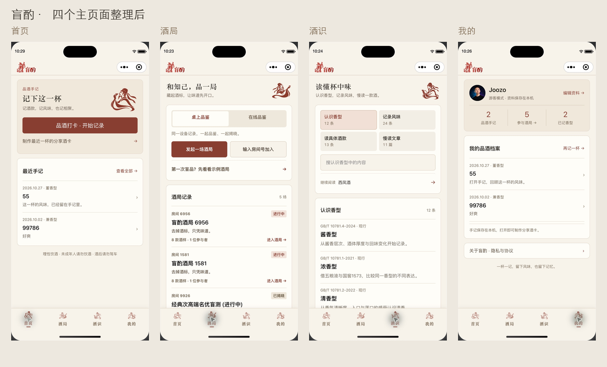
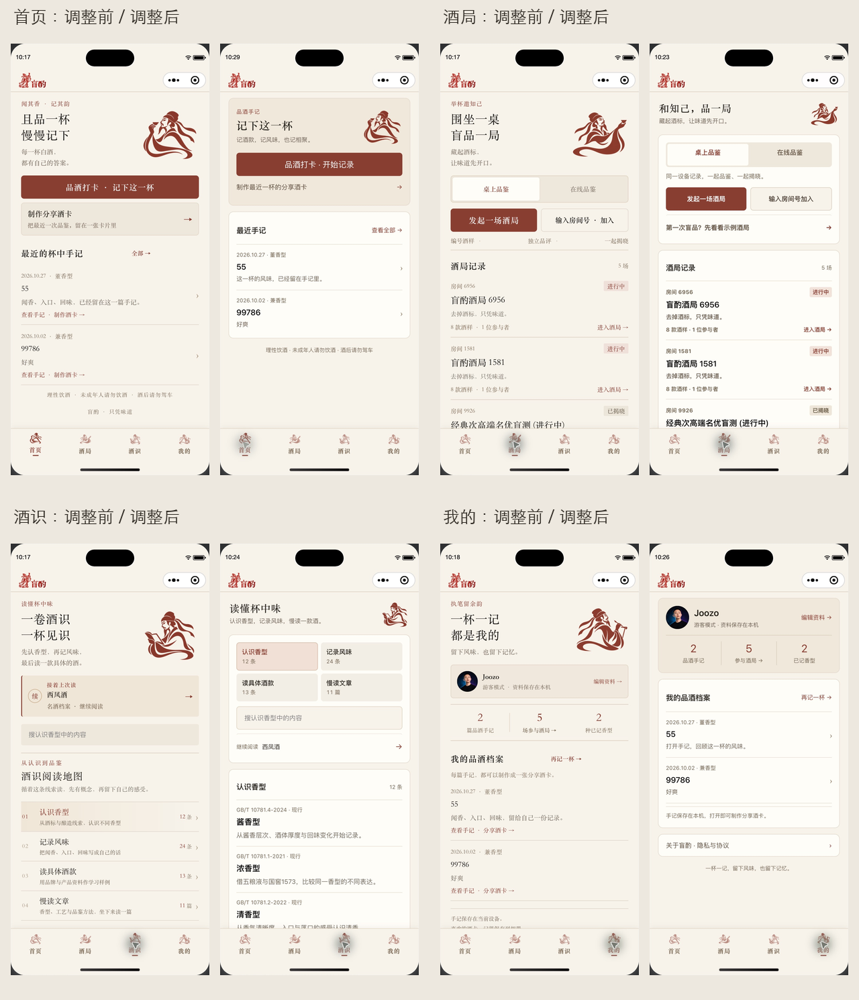

# 盲酌主页面整理与检查

2026-10-28，基于本轮微信开发者工具 iPhone 17 模拟器截图。

## 四页检查

1. 首页：原宣传、打卡、分享、手记各自分散。现归为「记录与分享入口」和「最近手记」两组；截图无明显溢出，打卡按钮可进入记录页。
2. 酒局：原大幅宣传与独立说明分散注意力。现将模式、发起/加入、示例归为一个操作区，酒局记录独立成组；模拟器切换桌上/在线模式正常，游客提示显示正常。在线列表后台联通不在本轮验收范围。
3. 酒识：原首页首屏几乎只有导读与分类，实际条目在下方。现四类入口以两列排列，搜索与续读一起归组，条目出现在首屏；已验证分类切换、搜索空结果、清空恢复、续读和返回。
4. 我的：原宣传、资料、统计、档案之间存在多处分隔。现资料与统计归一组，档案归一组，设置归一组；资料及原统计显示正常，手记可打开酒卡页。

## 设计边界

沿用现有 Logo、顶部细线、朱红与米白配色、李白原有插画与四个 tab。缩小插画，减少重复文案，标题保留宋体，正文及操作采用系统字体。仅修改四个主页面的模板与样式，新增作用域限定的共享样式，不修改业务请求、数据格式和存储逻辑。

所有新增主要交互使用 button；分类有选中语义。主要操作高度至少 44 CSS px。模拟器中未见横向撑破或文字遮挡；屏幕阅读器、系统大字体、其他尺寸及真机效果仍需另验，不能据截图声明完整无障碍合规。

## 验证

- 现有 Node 回归：36 项通过（含 3 个父测试）。
- 官方 WXML 编译：23 个文件通过。
- 官方 WXSS 编译：25 个文件通过。
- 四页 bindtap/bindinput 对应方法检查通过。
- UI 检查采用本机已有记录，未提交新手记、创建酒局、登录、评分或上传照片。
- 本轮未验证线上登录、跨设备共享、相机/相册权限或部署。

## 本轮实拍

四页新布局：

调整前与调整后，按首页、酒局、酒识、我的排序：

原始截图保存在同目录的 before-*.png、after-*.png，比较图只裁出模拟器画面并等比缩小。
