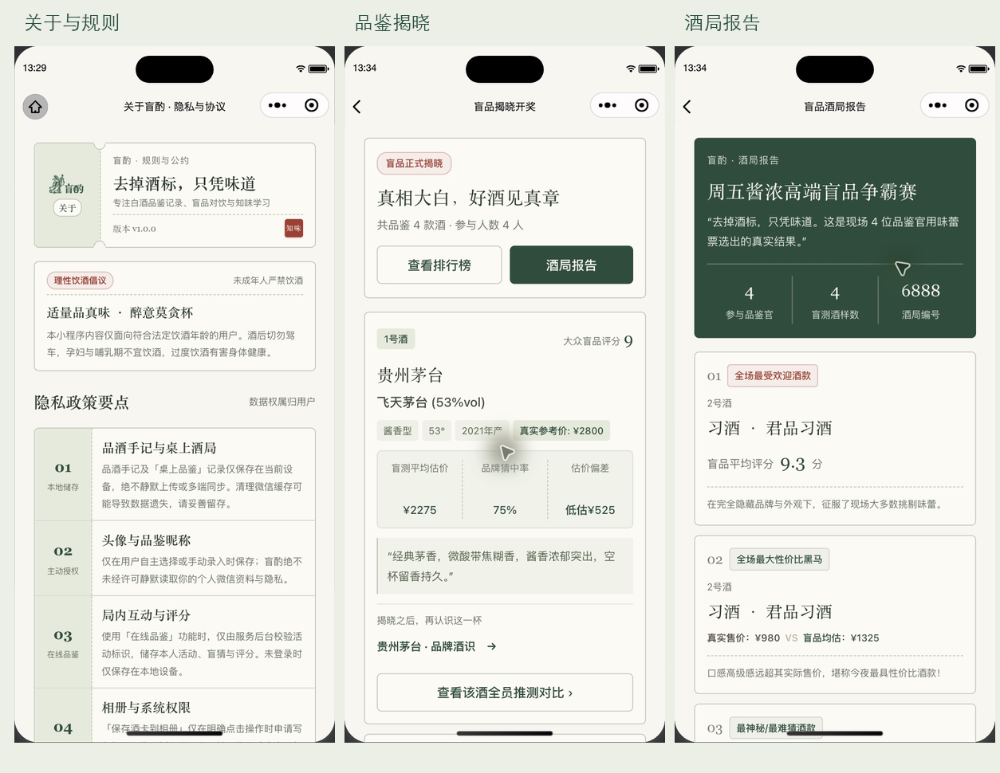
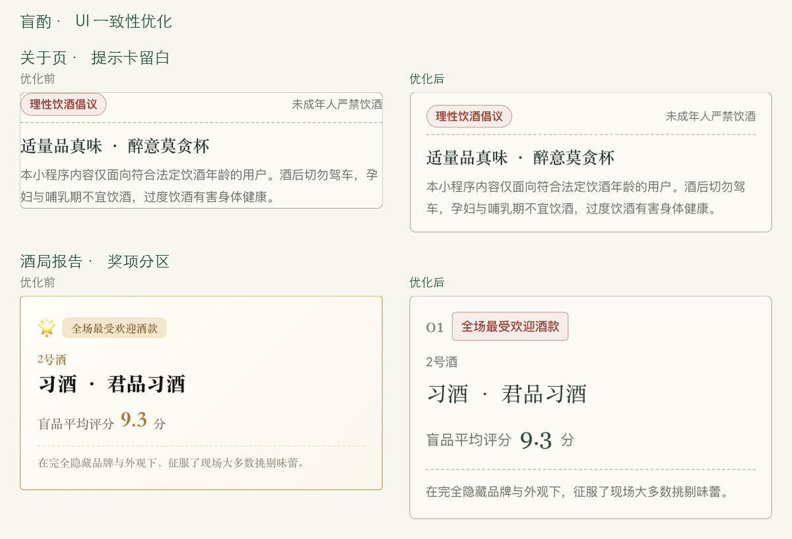
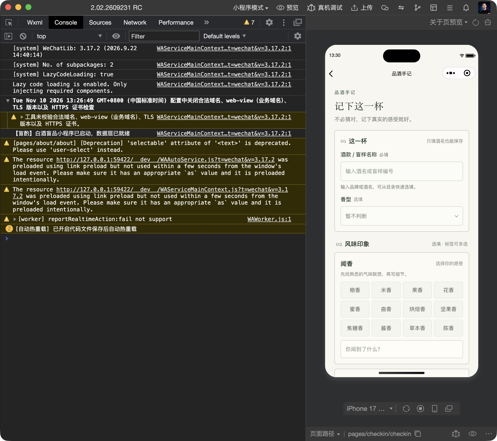
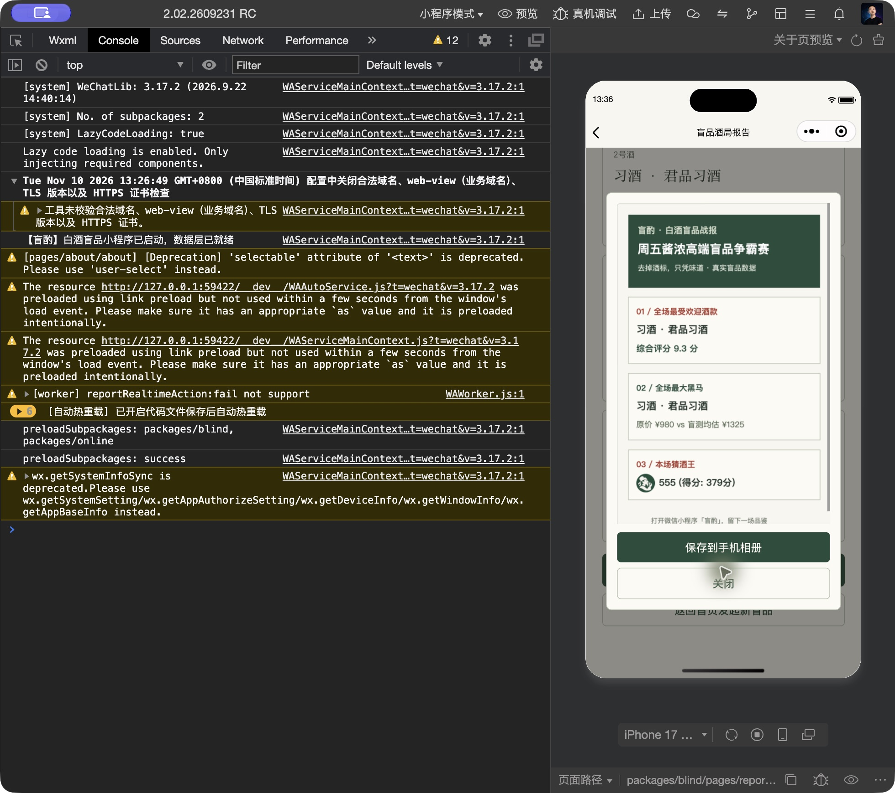
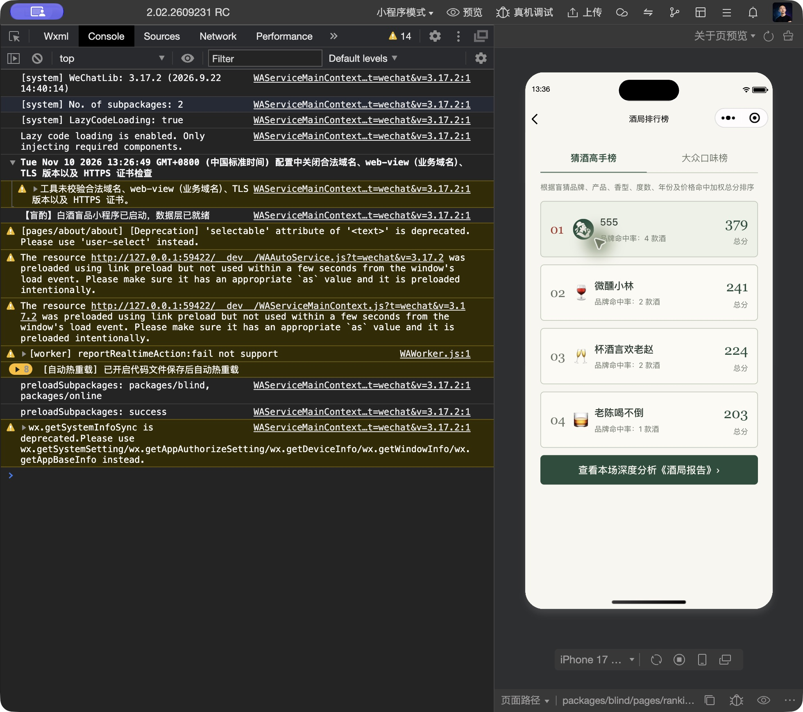
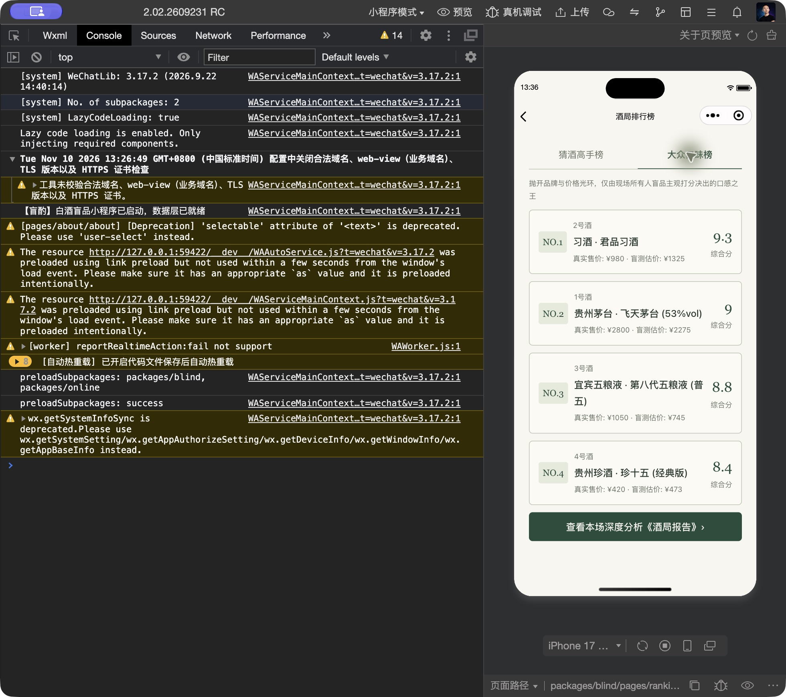
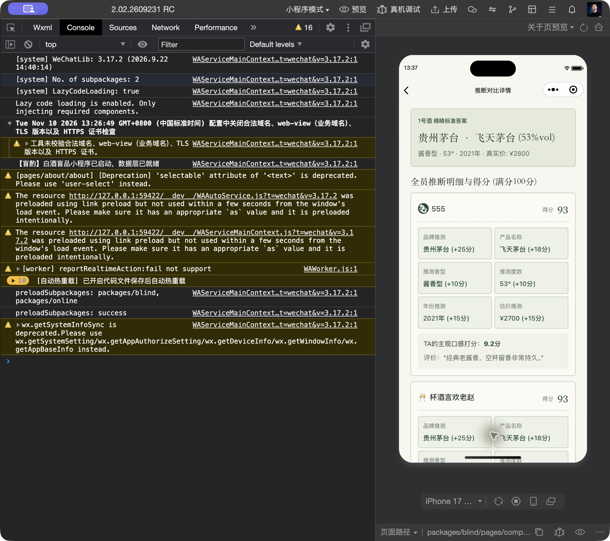
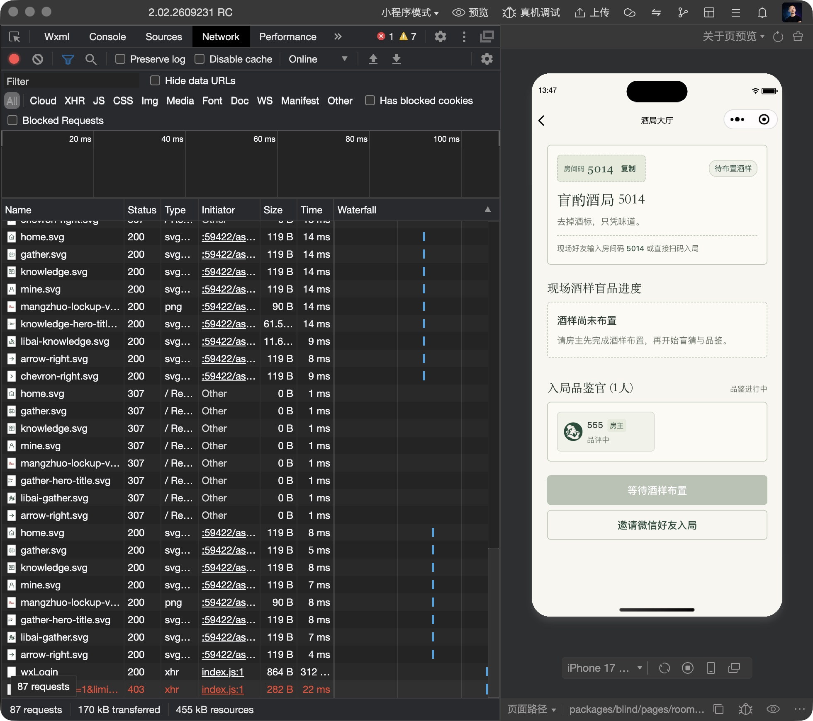
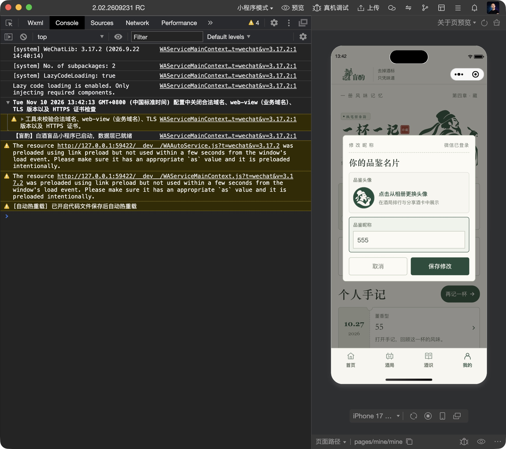
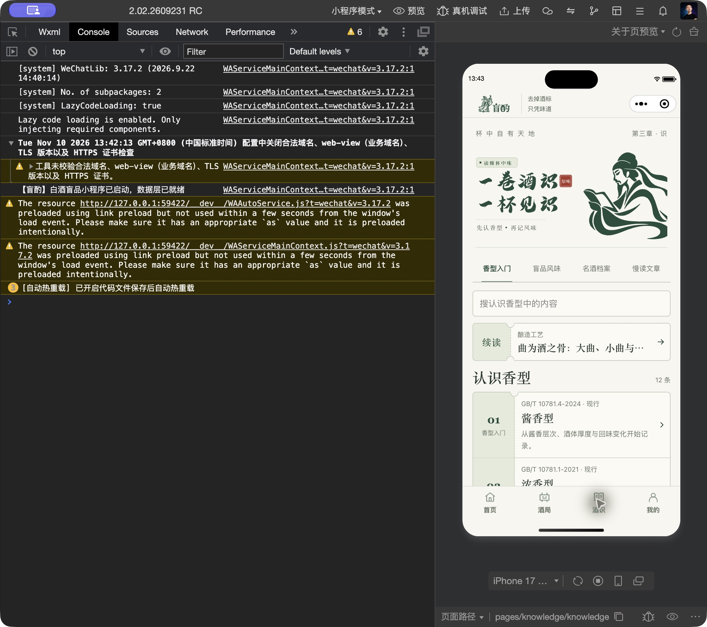

# 盲酌 UI 一致性检查与优化

日期：2026-11-10。沿用用户已选的方案 3：米白纸页、竹绿、票签分区、宋体标题和红印章。

## 范围与证据

检查 `app.json` 注册的全部 21 个页面及共享导航、表单、按钮样式。实际截图来自本轮微信开发者工具；未用历史设计稿替代运行截图。设备为 iPhone 17，逻辑视口 402 × 874；前期工具显示比例 100%，复核时改为 75% 以完整显示手机，逻辑视口未变。

主要流程实际查看了 11 个路由、两个榜单状态、资料弹窗和战报海报弹窗。其余路由完成代码和官方编译检查，不等同于逐页真机验收。

## 发现与处理

| 问题 | 本轮证据 | 处理 |
| --- | --- | --- |
| 关于页提示卡标题、正文贴着边框 | `01-about-before.png` | 修正通用 `.content-panel` 对提示卡内边距的覆盖；标题条允许换行 |
| 二级表单左右留白有 32、36、40rpx 等多套值 | `02-home-before.png`、`03-checkin-before.png` 和样式检查 | 页面基础留白统一 46rpx；350px 以下统一 36rpx；一级页面票签的既有局部出血保留 |
| 揭晓、榜单、对比、战报仍混用黑金渐变和旧字重 | `05-reveal-before.png`、`06-report-before.png`；榜单、对比为代码检查 | 统一纸色与竹绿、宋体标题、Georgia 数值及浅绿数据分区 |
| 同类卡片、按钮圆角及禁用颜色不一致 | 表单、揭晓、战报截图及共享样式 | 二级卡片 12rpx 圆角、28rpx 内边距；主次操作至少 48px；禁用态统一灰绿 |
| 揭晓数据列的分隔线依赖文字竖线 | `05-reveal-before.png` | 用真实边框分隔三列，标签与数值统一对齐，长文本允许换行 |
| 未布置酒样时显示 0/0，仍显示揭晓操作 | `10-room-empty-before.png` | 显示待布置状态和说明，隐藏 0/0，空酒样时禁用揭晓按钮 |
| 资料与海报弹窗的间距、遮罩和安全区不一致 | 资料弹窗代码、`07-poster-after.png`、`12-profile-modal-after.png` | 统一纸色、边框、遮罩和内边距，增加安全区及高度限制 |
| 部分操作是可点击 view，缺少按钮语义 | 房间、榜单 WXML | 房间码、酒样卡和榜单切换改成按钮，补充标签；榜单选中状态同时显示下划线与文字状态 |
| 战报海报仍使用旧黑金配色及无二维码的扫码说明 | 海报绘制代码、`07-poster-after.png` | 同步绿白配色、序号分区和红色强调；改为打开小程序的说明 |
| 战报固定显示“100% 双盲公平度” | `06-report-before.png` | 第三统计项改为当前真实酒局编号，保留真实人数与酒样数 |
| 在线列表 403 导致已确认的微信身份被清除 | 本轮开发者工具 Network 中 wxLogin 200、在线列表 403；隔离回归测试 | 403 作为功能访问失败显示，保留身份及凭证；401 继续使会话失效，写请求不重放 |

## 实际复核步骤

1. **关于页：已改善。** 提示卡恢复四周留白，标题条能容纳长标签；红印章保留。截图 `01-about-after.png`。
2. **首页：正常。** 既有书法、李白和票签构图保留，记录与酒卡入口可用。截图 `02-home-after.png`。
3. **品酒手记：已改善。** 标题、卡片和表单采用相同页面边线，输入与标签没有明显裁切。截图 `03-checkin-after.png`。未保存新记录。
4. **酒局：正常。** 章节、桌上/在线切换和已有记录正常显示；从实际记录进入揭晓与进行中房间。截图 `04-gather-after.png`。
5. **揭晓：已改善。** 状态、酒款、三列数据、品鉴描述和两个操作有清晰分区。截图 `05-reveal-after.png`。
6. **酒局报告：已改善。** 封面、统计、奖项编号和红色强调统一。截图 `06-report-after.png`、`07-report-actions-after.png`。
7. **战报海报弹窗：正常。** 实际生成本机图片，预览及保存/关闭按钮可见，关闭可用；没有写入相册或向外分享。截图 `07-poster-after.png`。
8. **排行榜：已改善。** 实际切换猜酒高手榜和大众口味榜；选中下划线和内容同步，长酒名可换行。截图 `08-ranking-guess-after.png`、`08-ranking-taste-after.png`。
9. **推测对比：已改善。** 标准答案、参与者、分项和口感评价分区清楚。截图 `09-compare-after.png`。
10. **进行中房间：已改善。** 房间号和成员区域统一样式；空酒样提示和禁用态另行在完整编译后复核。截图 `10-room-after.png`。
11. **我的：正常。** 完整编译后原头像、昵称、微信身份及本机统计保留。截图 `11-mine-after.png`。
12. **资料弹窗：已改善。** 打开昵称编辑、检查字段与按钮，取消后回到原页面，没有保存或替换用户资料。截图 `12-profile-modal-after.png`。
13. **酒识：正常。** 搜索、分类和票签延续既有样式；共享样式未破坏章节构图。截图 `13-knowledge-after.png`。

## 全部路由覆盖

| 页面 | 本轮覆盖 |
| --- | --- |
| 首页、酒局、酒识、我的 | 实际截图、导航复核、共享样式检查 |
| 关于、品酒手记、揭晓、报告、排行榜、推测对比、房间 | 实际截图及相关操作复核 |
| 独立资料页、分享酒卡页 | 页面样式、共用控件和官方编译检查 |
| 本机创建、酒样布置、加入、盲猜、评分、已提交 | 页面样式、共用控件和官方编译检查 |
| 在线创建、在线详情 | 边距与卡片样式、既有页面回归测试、官方编译检查 |

本轮原始运行截图按步骤编号保存在同目录。主要交互证据：

## 验证与边界

- 129 项 Node 回归通过，包含此前登录持久化、在线流程、本机资料保存，以及本次 403 不误退出的回归。
- 微信官方编译器检查 23 个 WXML、27 个 WXSS 通过；38 个 JavaScript 文件语法检查通过。
- `git diff --check` 通过。
- 控制台可见工具预加载、热重载及既有系统信息 API 弃用提示；Network 可见旧在线列表 403。当前修复通过隔离测试，403 修复后未重新登录或重试真实在线请求，不把接口访问失败算作在线功能验收通过。
- 真机、窄屏独立渲染、系统大字体、键盘弹起、VoiceOver、在线接口异常/空列表和双账号状态未在本轮完整验收。截图与编译通过不能证明这些状态的可访问性或视觉完全通过。
- 没有创建、评分、揭晓或删除用户酒局，没有修改头像昵称，没有上传或发布。

## 复用规则

共享基线位于 `miniprogram/styles/foundation.wxss`。一级页面继续使用 `organized.wxss` 的章节构图；二级页面复用页面留白、纸色、卡片、按钮和状态标签。彩色星级与用户自选 emoji 头像表达数据，保留原用途。
